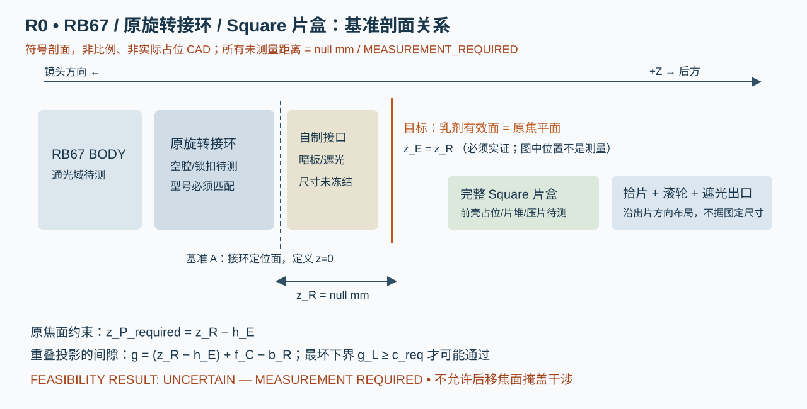

# R0 工程可行性研究与证据索引

日期：2026-10-07。适用范围：用户条款 1–66；本阶段只研究、定义参数和验证路径，不设计最终相机后背，不制造胶片化学品。

## 明确结论

**FEASIBILITY RESULT: UNCERTAIN — MEASUREMENT REQUIRED**

此结论针对“保留与 RB67 型号匹配的原装旋转接环，商售 Square 整片盒定位于原焦平面，独立电动处理”。不能给出 PASS，因为焦平面基准、接环空腔、片盒前缘至有效曝光面距离三个关键输入都没有实测。也不能给出 FAIL，因为尚未测得有单位的负间隙。不得把未知间隙记为 0 mm，不得使用随机论坛数值填空。

**推荐进入 R0/P0 测量和两套独立试验机研究，推荐双电机原型。** 推荐的是研发路径，不是宣称产品已可行。传送的四个问题——分离、拾片、滚轮交接、化学铺展——必须分别验收。

## 当前能回答与不能回答的项目

| 问题 | 当前答案 | 证据等级 / 下一步 |
|---|---|---|
| 相纸外形与图像 | 无轴向定义的边长 86 × 72 mm；图像 62 × 62 mm | MANUFACTURER_SPEC；[富士 SQUARE 规格](https://www.instax.com/squareformat/en/)；片盒坐标另测 |
| 每盒曝光数 | 10；另有初始遮光盖片 | 厂商使用资料；黑盖与曝光片必须分开计数，见 transport.md |
| RB 接口与锁扣精确坐标 | 未取得可制造、带公差的原厂尺寸图或可信实测 | UNKNOWN；M01/M02，禁止凭产品照描摹 |
| 原接环是否跨全部机身通用 | 不能作为统一接口假设 | 原厂手册存在初代/Pro-S/Pro-SD 兼容限制，见 film-plane.md |
| Square 片盒外形、进片口、拾片窗 | 已归档相盒参考 STL 并生成可查看的 STEP，尚无可追溯物理尺寸 | UNKNOWN；从源模型校核，见 open-cad-sources.md；M04–M08 |
| 片堆是否自己保持曝光面 | 不可假定片盒内弹性结构足够 | 专利提示外部压片件参与，须测完整后盖等效压片关系 |
| 保留接环能否达到焦平面 | 尚无法计算数字间隙 | UNKNOWN；闭合 film-plane.md 的尺寸链 |
| 62 × 62 是否完整通光 | 卷片名义 6×7 或卷片窗口不能证明 | 接环、光挡及有效光束通道都要实测，M03 |
| 片盒总厚度是否决定焦平面冲突 | 总厚度不足以单独判断 | 前壳占位、曝光面偏置、空腔和锁定面都参与 |
| 有无合理独立 transport 原理 | 有：分离片爪、压片、刚性滚轮、独立驱动已有公开原理 | 原始专利仅作原理证据，非生产规格，见 patents-and-prior-art.md |
| Fuji 滚轮直径、硬度、预载、速度 | 未取得 Square 专属可靠规格区间 | UNKNOWN；不能把用户的示例 DOE 数值改称厂商规格 |
| 商品 motor 是否足够 | 有候选规格可比较，负载未知 | 不能定型；测拾片力、真实药包峰值电流与滚轮扭矩 |
| 回退可否恢复所有卡片 | 不能保证 | 药包夹持后回退可能损坏铺展；一次有界恢复，失败进 SERVICE |
| 最终 PCB 尺寸及接口位置 | 当前机械布局不足以给出 | UNKNOWN；提供电气合同，尺寸发布条件见 interface-contract.md |

相纸规格由厂商页确认，但不同地区网页的 W/H 标注互换。中央参数记录长边/短边，只有建立片盒出片方向后才映射 X/Y，避免把一个网页的 W/H 当作拾片方向。

## 证据接受规则

`VERIFIED_MEASUREMENT`：有实物编号、原始读数、重复性、仪器和不确定度；本阶段 **0 项**。

`MANUFACTURER_SPEC`：厂商明确公布，必须注明型号/条件。电机堵转力矩不等于连续工作力矩。

`RELIABLE_SOURCE`：原厂说明书原文（即使由档案站镜像）或明确量测方法的独立工程资料；原理证据不自动升级为尺寸证据。

`DERIVED`：完整公式、输入来源和单位；含未知输入时结果仍为空。

`ESTIMATED`：预算、评分、设计目标或试验假设，不能写成已验证性能。

`UNKNOWN`：参数值 `null`，标记 `MEASUREMENT_REQUIRED`，提供操作方法，不参与固定实体或制造导出。来源、分类和定义均保存在 [parameters.json](../cad/parameters.json)。

检索范围覆盖富士产品/操作资料、RB67 原厂说明书镜像、瞬时胶片专利、后背制作者资料、商品电机/驱动/充电器数据表。未找到可信尺寸不代表尺寸不存在，只代表本次研究没有足够证据采用。零件商品目录只能证明可采购材质/尺寸，不能证明 Instax 化学处理性能。

## 第一轮需要用户提供的记录

请按 [measurements.md](measurements.md) 的 M01–M06 表测量，不要只给“一张侧面照片”或片盒总厚度。第一批最低输入是：机身和接环身份、接环后背定位面、相对该面原曝光面坐标、接环空腔轮廓、完整片盒前壳与最前曝光片支承面的关系。新片盒内层/药包不得剪切；优先空片盒和已显影片建立工具，真实装片深度与压片关系在避光条件下验证。

在获得这些值之前，尺寸链、模块包络、PCB 板框、视屏遮片和 STEP/STL 均不能冻结。可以并行做有调整余量的独立实验平台，不能以平台可运转替代相机接口可行性。

## 开源与第三方资料边界

自写研究文档按本项目许可证发布。建议后续机械与电子 source 使用 CERN-OHL-P/W/S 中合适的一种，固件使用 MIT；选型与完整许可文本随实际 source 交付。CERN 的三种 v2 变体及说明见 [CERN 官方许可页](https://cern-ohl.web.cern.ch/)。已有带来源和各自许可的第三方原件归档在 cad/reference，未重新授权。参考名义几何与物理参数分开；有 NC 限制的 Super-67 只作非商业比较。

专利文献帮助理解压片和输送原理，不提供自由实施保证。后续独立绘制全部工程几何、保留推导和测量记录；若准备商业制造，再按实际制造/销售地区核实权利要求与法律状态。不得把“公开/早期/页面显示 expired”写成跨地区授权；详细索引见 [patents-and-prior-art.md](patents-and-prior-art.md)。

## 阶段退出条件

R0 几何子门结束须能以毫米计算基准、空腔和片盒最不利占位并确认图像通光域。若仍缺值，结论保持 UNCERTAIN；若完整片盒在原焦平面不可消除地重叠，结论为 FAIL，而不是移动乳剂或改要求。原片盒和原接环保留且量测证实自制件凹腔/模块外移可解决时，只能先记录“几何子门通过，修改量为实测毫米数”。整体 PASS 或 PASS WITH MODIFICATION 还必须通过 film-plane.md 的焦面、通光、旋转、暗板/出口及中途拆背验证门。首阶段文档完成不等于 R0 实测门槛通过。

## 已有 CAD 检索增补

[open-cad-sources.md](open-cad-sources.md)记录本轮一手检索。优先 G 接口 CC BY 上游和 CC0 Square 压片组件；包括相盒 STL 在内的 19 个原始资产已经归档，10 个网格的名义几何已检查。相盒参考转换为分面 STEP 后通过实体内核检查，几何有效性不代表尺寸实测。G 接收侧不能直接当后背配合侧；缺原接环空腔和原曝光面基准，因此可行性仍 UNCERTAIN。
